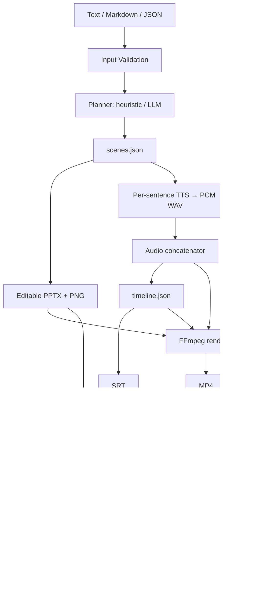

# 体系架构与技术决策

## 输入契约

输入为 `UTF-8` 文本，扩展名 `.md` / `.txt` / `.json`。JSON 必须含 `body` 字符串，可选 `title`。Markdown 首行 `# ...` 视为标题，其他段落为正文。单文件最多 3 MB；不自动联网搜索或下载新闻。

## 核心数据流

### 不变量

1. `scene.id` 全局唯一；场景排序决定 `slide_index`，从 1 开始。
2. `timeline.scenes` 严格连续，首场景从 0 开始，末场景结束时间等于总 WAV 实际时长（毫秒四舍五入）。
3. 字幕必须单调、互不重叠，并位于其所属场景时间范围内；句尾休止时间不分配给字幕。
4. WAV 固定 mono / signed 16-bit PCM / 配置采样率，记录 `duration_samples` 防止浮点累积误差。
5. 视频总时长与音频时长误差不得超过可配置阈值；FFmpeg CFR 画面边界允许约 1 帧量化。
6. 任一步失败都不生成状态为 `qa_passed` 的发布包；必须成功完成质量验收后原子切换目录。
7. 本地文件由绝对内容哈希记录；对相同输入、配置和代码版本优先复用，无需重复调用 TTS/LLM。

## 缓存与可恢复性

`run_id=SHA256(raw_input_bytes + canonical_config + source_url + engine_version)[0:16]`。同一 `run_id` 加 POSIX 文件锁以避免同一输出目录同时写入。TTS 句子缓存使用文本+语音配置+引擎版本的独立哈希。完成的输出目录带有 Manifest 哈希，可验证完整性后直接复用；损坏则重算。构建中使用 `.building-*` 临时目录，失败后保留供排查。

**范围说明**：这是 v0.1 的「结果级跳过 + TTS 句子缓存」，尚不是分步骤缓存恢复。后续应引入 `StageArtifact` DAG，满足 LLM/素材/布局粒度的缓存并对工具、字体、模型二进制做版本锁定。

## Provider 设计与建议接口

- `Planner`: `plan(title, source_text) -> Scene[]`，默认可复现规则规划；可选 OpenAI-compatible Chat Completions 接口。
- `TTS`: `synthesize(sentence, voice_config) -> mono PCM WAV`；当前 espeak(-ng)、Edge；将来可加入 CosyVoice/Qwen3-TTS/Piper。
- `ASRQuality`: `check(wav, expected_text) -> similarity`；目前 faster-whisper 只在显式启用时加载；模型下载需联网。
- `Renderer`: PPTX 原生形状和 PIL PNG 都由 `Scene` 驱动；FFmpeg 合成 MP4；未来替换为 HTML/Canvas/Remotion 引擎也不修改 timeline 契约。
- `Publisher`: 当前没有实现；未来必须将平台鉴权/审查/投稿/查询状态做成独立模块。

## 已知设计取舍

- PPTX 文字可编辑，但当前 PIL 视频幻灯片与 Office 渲染不是像素级一致（字体/排版器差异），视频以 PNG 为准。
- 规则规划按句和段切分，不保证复杂新闻语义和摘要质量；LLM 规划只是内容草稿，必须经人工审核。
- 默认 espeak 中文音色受限，推荐实际制作使用有授权的中文 TTS 服务；不能因技术 QA 通过就视为内容可发布。
- 当前仅 16:9，未生成封面页/目录页、词级字幕、动画、竖版重排或发布者上传逻辑。

## 未来事实核验设计

单独增加 `SourceEvidence`，包含 `source_id, url, published_at, retrieved_at, quote_spans, rights_status, hash`，`StoryClaim` 关联证据和有效期。LLM 的任何分析结论应包含 `fact/inference/unknown` 标记，涉及政策与统计的数字强制二次比对，不能把无来源结果自动提交为真。
